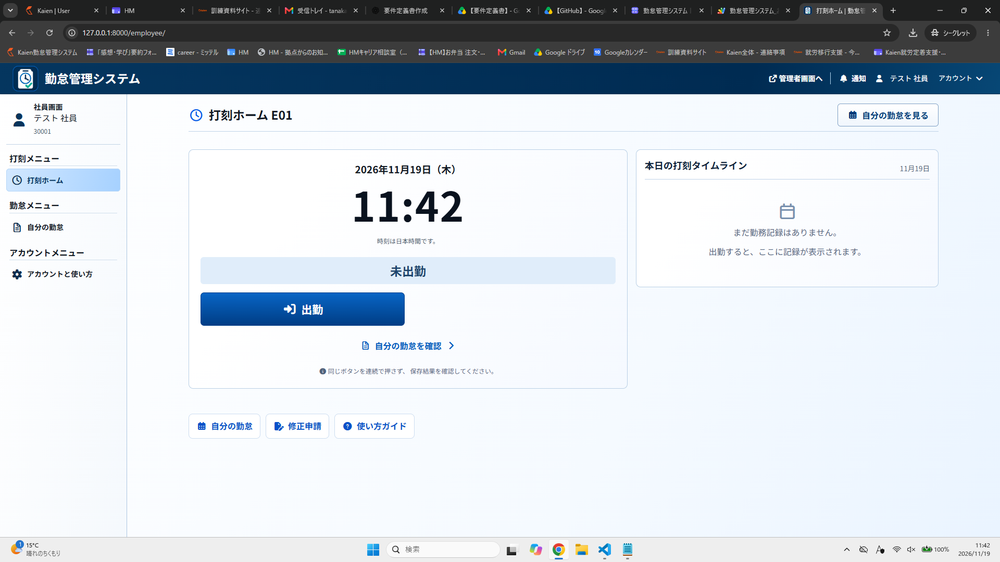

# 勤怠管理システム

Djangoを使用して開発した、社員の勤怠記録と管理者の勤怠管理業務を支援するWebアプリケーションです。

UI（ユーザーインターフェース）・UX（ユーザーエクスペリエンス）・UD（ユニバーサルデザイン）・アクセシビリティ・レスポンシブデザインを重視し、利用者が直感的に操作できるシステムを目指して開発しました。

---

## 1. プロジェクト概要・基本情報

### プロジェクト概要

本システムは、社員の出退勤・休憩時間の記録から、管理者による勤怠情報の確認・修正承認・月次確定・CSV出力までを管理するWebアプリケーションです。

一般社員向け画面と業務管理者向け画面を分離し、それぞれの利用目的に応じた機能と操作画面を提供します。

### 基本情報

| 項目 | 内容 |
|---|---|
| システム名 | 勤怠管理システム |
| 開発者 | Rion Tanaka |
| 制作名 | RionWorks |
| バージョン | v1.5.7 |
| 開発状況 | 開発完了 |
| 開発開始日 | 2026/10/15 |
| 最終更新日 | 2026/11/19 |
| 対象ユーザー | 一般社員・業務管理者 |
| 対応言語 | 日本語 |
| アプリケーション形式 | Webアプリケーション |
| 開発フレームワーク | Django |
| 本番運用状況 | 【未実施／準備中／運用中】 |

### 開発目的

本システムは、勤怠管理業務の効率化と、利用者にとって分かりやすい操作環境の提供を目的としています。

主な目的は以下のとおりです。

- 出勤・退勤・休憩時間の記録を効率化する
- 勤怠情報を一元管理する
- 打刻修正申請と承認業務を効率化する
- 社員情報・部署情報を適切に管理する
- 月次勤怠の確認とCSV出力を効率化する
- 利用者の権限に応じた機能を提供する
- 誰でも分かりやすく操作できる画面を実現する

---

## 2. 制作背景

前職の福祉サービスの職場で、C#を使用した勤怠管理のデスクトップアプリケーションを制作した経験があります。

この経験をもとに、同じ勤怠管理を題材として、ブラウザーから利用できるWebアプリケーションを開発したいと考え、Djangoで開発を行いました。

以前のアプリケーションでは、共通の画面でIDを入力し、出退勤の打刻や勤怠状況の確認を行う仕組みでした。

今回のWebアプリケーションでは、一般社員と業務管理者で必要な操作が異なることから、それぞれの画面を分離しました。

一般社員は自分自身の勤怠情報のみを確認でき、業務上の権限を持つ管理者は、全社員の勤怠情報を確認・管理できる仕組みとしています。

また、UI・UX・ユニバーサルデザイン・アクセシビリティ・レスポンシブデザインを重視することで、幅広い利用者が迷わず操作できるシステムを目指しました。

---

## 3. 主な機能

本システムに実装した主な機能を以下に示します。

### 3.1 一般社員向け機能

- ログイン・ログアウト
- 出勤・退勤の打刻
- 休憩開始・休憩終了の打刻
- 勤怠履歴の確認
- 日別・月別の勤怠確認
- 打刻修正申請
- 修正申請状況の確認
- アプリ内通知
- 勤怠グラフの表示
- パスワード変更

### 3.2 管理者向け機能

- 社員情報の登録・編集
- 社員アカウントの利用停止・再有効化
- 部署登録・管理
- 部署別の社員番号自動採番
- 初期パスワードの自動生成
- 全社員の勤怠一覧
- 修正申請の承認・差戻し
- 月次勤怠の確定・解除
- 日次・月次CSV出力
- 業務管理者の権限管理
- 操作履歴の確認
- アプリ内通知
- 勤怠集計グラフ

---

## 4. スクリーンショット

本システムの主な画面を紹介します。

### 4.1 一般社員向け画面

#### 打刻ホーム



#### 勤怠履歴・勤怠確認


#### 打刻修正申請


#### 通知画面


### 4.2 管理者向け画面

#### 管理者ダッシュボード


#### 社員管理


#### 部署管理


#### 勤怠管理


#### 修正申請の承認


#### 勤怠集計グラフ


※ 画面はイメージです。バージョンによって、変更されている場合があります。

---

## 5. 技術構成・技術的な工夫

### 5.1 使用技術

| 分類 | 使用技術 |
|---|---|
| バックエンド | Python / Django |
| フロントエンド | HTML5 / CSS3 / JavaScript |
| テンプレートエンジン | Django Templates |
| グラフ | Chart.js |
| アイコン | Font Awesome |
| フォント | Google Fonts |
| データベース | SQLite（db.sqlite3） |
| 開発エディター | Visual Studio Code |
| 開発OS | Windows 11 |

### 5.2 技術的な工夫

#### ① 利用者ごとの権限制御

一般社員と業務管理者で利用できる機能を分離しました。

一般社員が他の社員の勤怠情報を閲覧・変更できないようにし、業務管理者のみが全社員の勤怠管理業務を実行できる設計としています。

また、管理者自身の修正申請を自己承認できない仕組みを設けています。

#### ② 部署別の社員番号自動採番

社員登録時に部署を選択すると、その部署に対応した社員番号を自動採番する仕組みを採用しています。

部署ごとに採番範囲を管理し、退職などによって欠番が発生した場合でも、使用済み番号を再利用しない設計としています。

また、社員の所属部署が変更された場合は、変更後の部署に対応した社員番号を割り当てる仕組みとしています。

#### ③ 勤怠データと変更履歴の管理

出勤・退勤・休憩の記録に加え、打刻修正申請によって変更された内容を管理できるようにしています。

原記録と修正内容を区別し、変更履歴を確認できる設計としています。

#### ④ 月次確定とCSV出力

管理者が月次勤怠を確認し、確定したデータをCSV形式で出力できる仕組みを採用しています。

勤怠の確定状態と出力対象のデータを管理することで、データの整合性に配慮しています。

#### ⑤ グラフによる勤怠情報の可視化

Chart.jsを使用して、勤怠情報を視覚的に確認できるようにしています。

グラフだけでなく、数値情報も確認できる画面構成としています。

### 5.3 デザイン方針

#### UI・UX

- シンプルで分かりやすい画面構成
- 直感的に操作できるナビゲーション
- 必要な機能へ素早くアクセスできる設計
- 操作ミスを防止するための案内表示

#### ユニバーサルデザイン

- 幅広い利用者に配慮した画面設計
- 読みやすい文字と配色
- 分かりやすいボタンやアイコン

#### アクセシビリティ

- WCAG 2.2 レベルAAを適合目標とした設計
- キーボード操作への配慮
- 適切なコントラスト
- 分かりやすいエラーメッセージ

#### レスポンシブデザイン

以下のデバイスでの利用を想定しています。

- デスクトップPC
- ノートPC
- タブレット
- スマートフォン

---

## 6. ディレクトリ構成

```text
attendance_system_v1.5.7/
├── accounts/              # アカウント管理
├── attendance/            # 打刻・勤怠記録
├── auditlog/              # 操作の監査ログ
├── config/                # Djangoのプロジェクト設定
├── corrections/           # 勤怠記録の修正申請
├── management/            # 社員・部署・権限の管理
├── notifications/         # 通知機能
├── templates/             # DjangoのHTMLテンプレート
│   ├── accounts/          # アカウント関連画面
│   ├── components/        # 共通UI部品
│   ├── corrections/       # 修正申請画面
│   ├── employee/          # 一般社員向け画面
│   ├── management/        # 管理者向け画面
│   └── notifications/     # 通知画面
├── static/                # 静的ファイル
│   ├── css/
│   ├── img/
│   ├── js/
│   └── vendor/
│       └── chartjs/       # Chart.js
├── docs/                  # プロジェクト資料
├── scripts/               # 運用・保守用スクリプト
├── manage.py              # Django管理コマンド
└── requirements.txt       # Pythonの依存パッケージ
```

※ 主要なディレクトリとファイルを記載しています。

---

## 7. インストール・起動方法

Windows環境でのローカル起動手順を示します。

### 7.1 動作環境（推奨）

| 項目 | 内容 |
|---|---|
| OS | Windows 11 |
| MacOS | 不明 |
| Python | 3.12.10 |
| Django | 5.2.19 |
| データベース | SQLite（db.sqlite3） |

### 7.2 プロジェクトの取得

GitHubからリポジトリをダウンロードし、任意のフォルダーに展開してください。

### 7.3 仮想環境の作成

PowerShellを開き、プロジェクトのルートディレクトリで以下を実行します。

```powershell
py -m venv .venv
```

### 7.4 仮想環境の有効化

```powershell
.\.venv\Scripts\Activate.ps1
```

### 7.5 必要なパッケージのインストール

```powershell
py -m pip install -r requirements.txt
```

### 7.6 環境設定

【必要な環境変数とデータベースの設定方法を記載】

※ 実際のパスワードや秘密鍵は公開しないでください。

### 7.7 データベースのマイグレーション

```powershell
py manage.py migrate
```

### 7.8 管理者の初期設定

【実際の初期管理者作成手順を記載】

※ Djangoの技術管理用アカウントと、本システム独自の業務管理者権限は区別してください。

### 7.9 開発サーバーの起動

```powershell
py manage.py runserver
```

### 7.10 ブラウザーでアクセス

以下のURLにアクセスしてください。

http://127.0.0.1:8000/

※ この起動方法はローカル開発用です。本番環境での運用方法とは異なります。

---

## 8. ユーザー権限・対応範囲

### 8.1 ユーザー権限

本システムでは、一般社員と業務管理者の2種類の業務上の権限を設定しています。

| 機能 | 一般社員 | 業務管理者 |
|---|---|---|
| 自分の打刻 | ○ | ○ |
| 自分の勤怠確認 | ○ | ○ |
| 自分の修正申請 | ○ | ○ |
| 全社員の勤怠確認 | × | ○ |
| 修正申請の承認・差戻し | × | ○ |
| 社員情報の管理 | × | ○ |
| 部署登録 | × | ○ |
| 月次勤怠の確定・解除 | × | ○ |
| CSV出力 | × | ○ |
| 業務管理者の権限管理 | × | ○ |

### 8.2 権限制御のルール

- 一般社員は自分自身の勤怠情報のみ閲覧できます。
- 業務管理者は権限の範囲内で全社員の勤怠情報を管理できます。
- 修正申請の自己承認・自己差戻しは禁止しています。
- 管理者自身の月次確定・解除は別の管理者が行います。
- 有効な業務管理者を2人以上配置する運用を前提としています。

### 8.3 対応範囲

- 固定時間制の勤怠記録
- 1日1勤務を基本とする打刻
- 複数回の休憩
- 日付をまたぐ勤務
- 勤怠修正申請
- 月次勤怠の確定
- CSV出力

### 8.4 初期版の対象外

以下の機能は、初期版の対象外としています。

- 給与計算
- 有給休暇の付与・残数管理
- 休暇申請
- シフト作成
- GPS打刻
- 生体認証
- ICカード打刻
- 外部サービス連携

---

## 9. セキュリティ

本システムでは、ユーザー認証・アクセス制御・個人情報保護を重視しています。

### 9.1 主なセキュリティ対策

- ユーザー認証とアクセス制御
- パスワードのハッシュ化
- 権限に応じた機能制限
- CSRF対策
- 操作履歴の記録
- 秘密情報の適切な管理
- 不正な操作・アクセスへの対策

### 9.2 アカウント管理

- 新規社員登録時に初期パスワードを自動生成
- 初回ログイン時のパスワード変更
- 社員アカウントの利用停止・再有効化
- 業務管理者権限の付与・取消
- 管理操作の履歴記録

### 9.3 GitHub公開時の注意事項

以下の情報はリポジトリに含めないでください。

- `.env` などの環境変数ファイル
- SECRET_KEYなどの秘密鍵
- APIキー
- データベースの接続パスワード
- 実際の社員情報
- 実データを含むデータベース
- バックアップファイル
- テスト用アカウントの実際のパスワード

公開前に、現在のファイルだけでなく、Gitの過去のコミット履歴も確認してください。

---

## 10. テスト結果

### 10.1 自動テスト

Djangoのテスト機能を使用して、システムの動作確認を行いました。

| 項目 | 結果 |
|---|---|
| 実施日 | 2026/11/19 |
| テスト件数 | 344件 |
| 成功 | 344件 |
| 失敗 | 0件 |

### 10.2 テスト実行コマンド

```powershell
py manage.py test
```

### 10.3 主なテスト対象

- ログイン・ユーザー認証
- 出勤・退勤・休憩の打刻
- 勤怠時間の計算
- 修正申請と承認処理
- 社員登録・社員情報の管理
- 部署管理・社員番号自動採番
- ユーザー権限制御
- CSV出力
- 通知機能
- 操作履歴

### 10.4 テスト環境

| 項目 | 内容 |
|---|---|
| OS | Windows 11 |
| Python | 3.12.10 |
| Django | 5.2.19 |
| データベース | SQLite（db.sqlite3） |

### 10.5 その他の検証

レスポンシブ表示、アクセシビリティ、同時操作、セキュリティなどの検証結果は、自動テストとは区別して記録します。

【実施済みの検証内容と結果を記載】

---

## 11. ライセンス・お問い合わせ

### 11.1 ライセンス

現在、本リポジトリにはオープンソースライセンスを設定していません。

### 11.2 お問い合わせ

不具合報告や改善要望については、以下からお問い合わせください。

https://forms.gle/iWeCt6rDpUH4fN7s9

---

## 12. 開発者情報

### Rion Tanaka

Webサイト・Webアプリケーションの開発に取り組んでいます。

利用者にとって分かりやすく、使いやすいシステムの制作を目指しています。

---

Copyright © 2026 Rion Tanaka
