# 勤怠管理システム

**Python / Djangoを使用した、社員の勤怠記録と管理者の勤怠管理業務を支援するWebアプリケーションです。**

一般社員向けの出退勤・休憩打刻、勤怠履歴の確認、修正申請と、業務管理者向けの社員・部署管理、申請承認、月次確定、CSV出力などを対象としています。

前職でC#による勤怠管理デスクトップアプリケーションを制作した経験を活かし、Webアプリケーションとして新たに開発しました。

UI・UX・ユニバーサルデザイン・アクセシビリティ・レスポンシブデザインを重視するとともに、業務上の権限制御、データの整合性、操作履歴、保守性にも配慮しています。

本リポジトリは、Webアプリケーション開発の成果物を紹介する**ポートフォリオ**です。

**開発状況：** 要件定義書 v1.5.7 ／ 本番運用未実施。機能の説明には、実装済みの内容に加えて設計仕様を含みます。

---

## 1. プロジェクト概要

### 1.1 基本情報

| 項目                 | 内容                 |
| -------------------- | -------------------- |
| システム名           | 勤怠管理システム     |
| 開発者               | Rion Tanaka          |
| 制作名               | RionWorks            |
| 要件定義書バージョン | v1.5.7               |
| 開発開始日           | 2026年10月15日       |
| 要件定義書最終更新日 | 2026年11月19日       |
| アプリケーション形式 | Webアプリケーション  |
| 対象ユーザー         | 一般社員・業務管理者 |
| 対応言語             | 日本語               |
| 開発フレームワーク   | Django               |
| データベース         | SQLite               |
| 本番運用状況         | 未実施（準備中）     |

### 1.2 主な特徴

- **社員・管理者別の画面：** 利用目的と権限に応じた画面構成
- **勤怠記録：** 出退勤・複数回の休憩・日付をまたぐ勤務に対応する設計
- **勤怠修正：** 追加・変更・取消の申請と承認・差戻し
- **社員・部署管理：** 部署登録、社員番号の自動採番、アカウント管理
- **月次勤怠管理：** 照合・確定・解除・再確定とCSV出力
- **権限制御：** 自己承認の禁止と管理者権限の管理
- **操作履歴：** 勤怠修正や管理操作の証跡を記録
- **通知機能：** 申請や月次確定などに関するアプリ内通知
- **データ可視化：** Chart.jsによるグラフと数値表
- **アクセシビリティ：** WCAG 2.2 レベルAAを適合目標とした設計

### 1.3 想定する利用環境

日本国内の単一企業で利用する、日本語の勤怠管理システムを想定しています。

| 項目             | 設計上の想定          |
| ---------------- | --------------------- |
| 登録社員数       | 100人                 |
| 同時利用者数     | 20人                  |
| 勤務制度         | 固定時間制            |
| 勤務単位         | 1日1勤務を基本        |
| 休憩             | 1勤務で複数回記録可能 |
| 日付をまたぐ勤務 | 対応対象              |
| 月次処理         | 月末締め              |
| データベース     | SQLite                |

登録人数・同時利用人数は設計上の想定値です。

---

## 2. スクリーンショット

本システムの主な画面を紹介します。

### 2.1 一般社員向け画面

#### 打刻ホーム

出勤・退勤・休憩開始・休憩終了の打刻を行う画面です。現在の勤務状態や最後の打刻記録を確認できます。

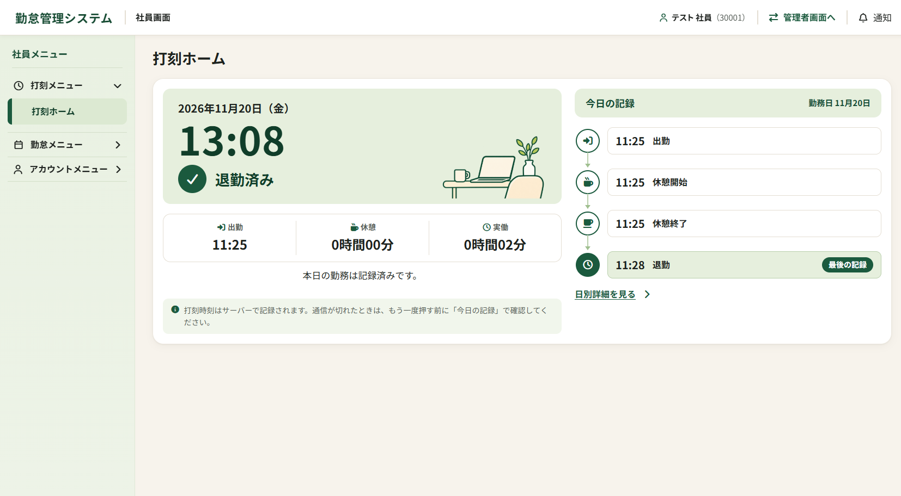

#### 自分の勤怠

自分の勤怠情報を日別・月別に確認する画面です。出退勤時刻、休憩時間、実働時間、申請状況などを確認できます。

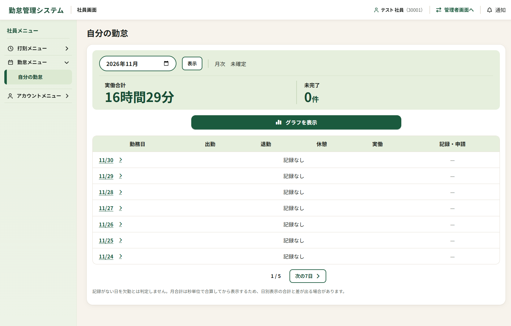

#### 日別詳細と修正申請

選択した日付の勤怠情報を詳しく確認する画面です。打刻内容に誤りがある場合は、修正理由を入力して追加・変更・取消の申請を行えます。

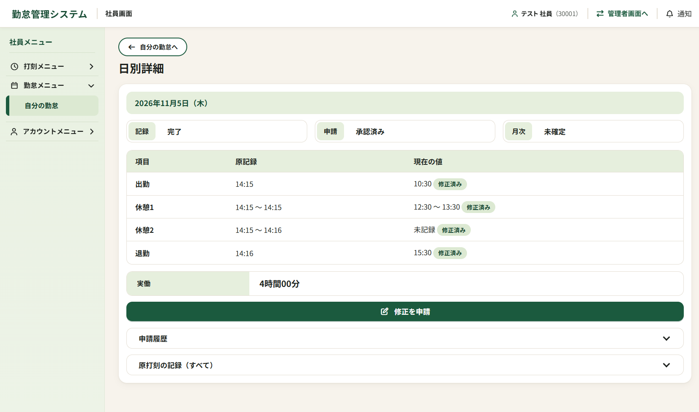<br>
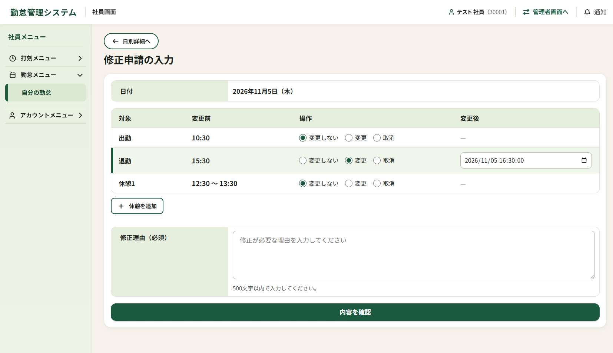

#### アカウントと使い方

パスワードの変更や、システムの操作方法を確認する画面です。各機能の使い方を確認でき、初めて利用する人でも操作手順を把握できるようにしています。

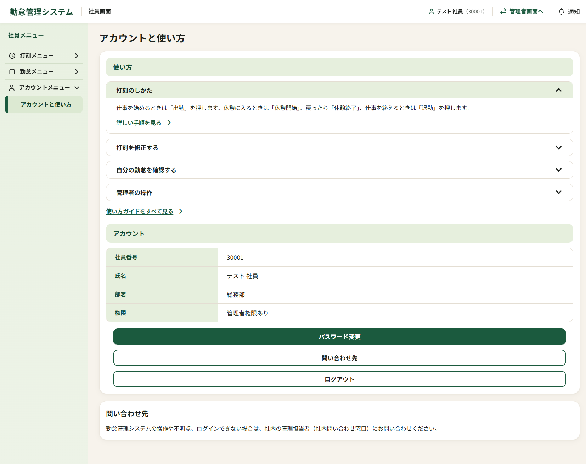

#### 通知パネルと一覧

勤怠修正申請の処理結果や未完了記録、月次確定などの通知を確認する画面です。未読通知の確認や既読管理ができ、通知から関連する画面へ移動できます。

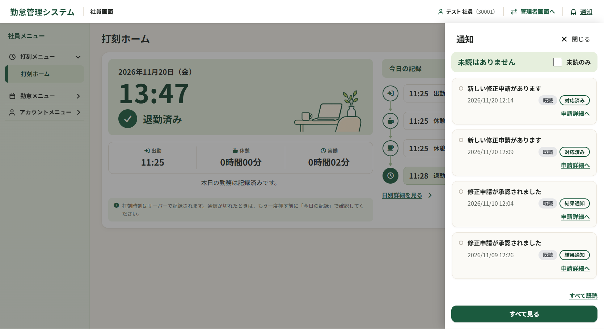<br>
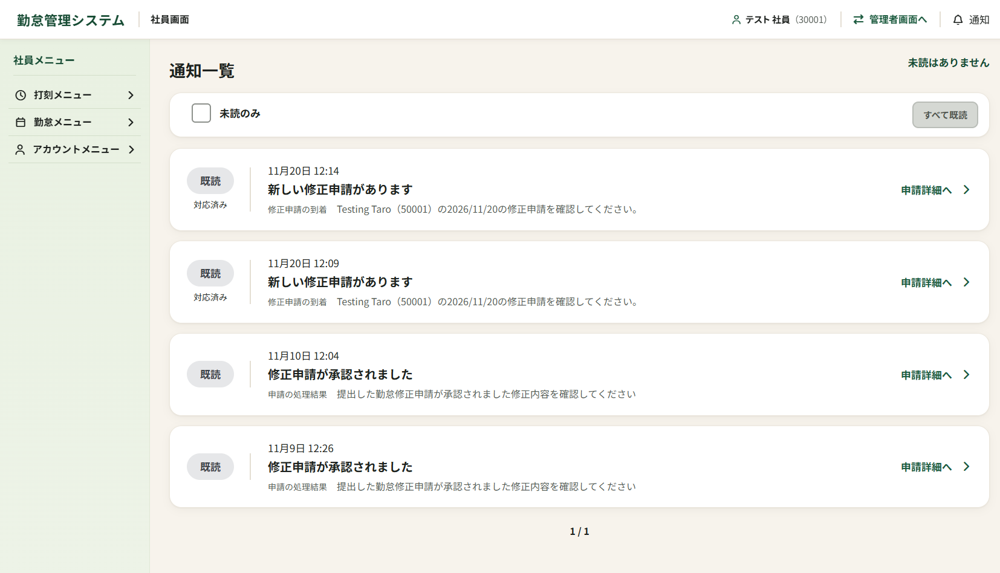

### 2.2 業務管理者向け画面

#### 勤怠一覧

全社員の勤怠状況を一覧で確認する画面です。社員名・社員番号・部署などで検索でき、未完了の勤怠記録や修正申請の状況を確認できます。

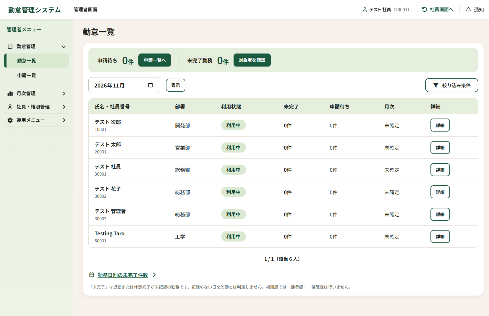

#### 申請一覧と詳細

社員から提出された勤怠修正申請を確認・処理する画面です。修正前後の内容や申請理由を確認し、承認または差戻しを行えます。

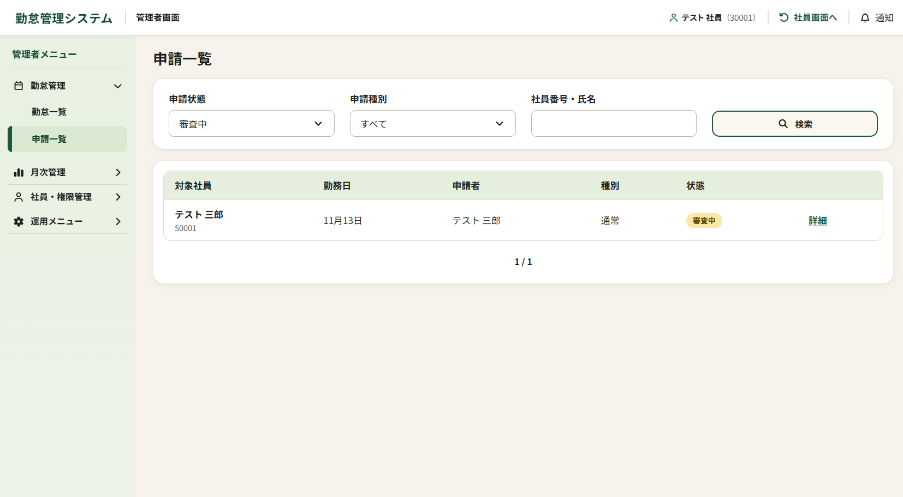
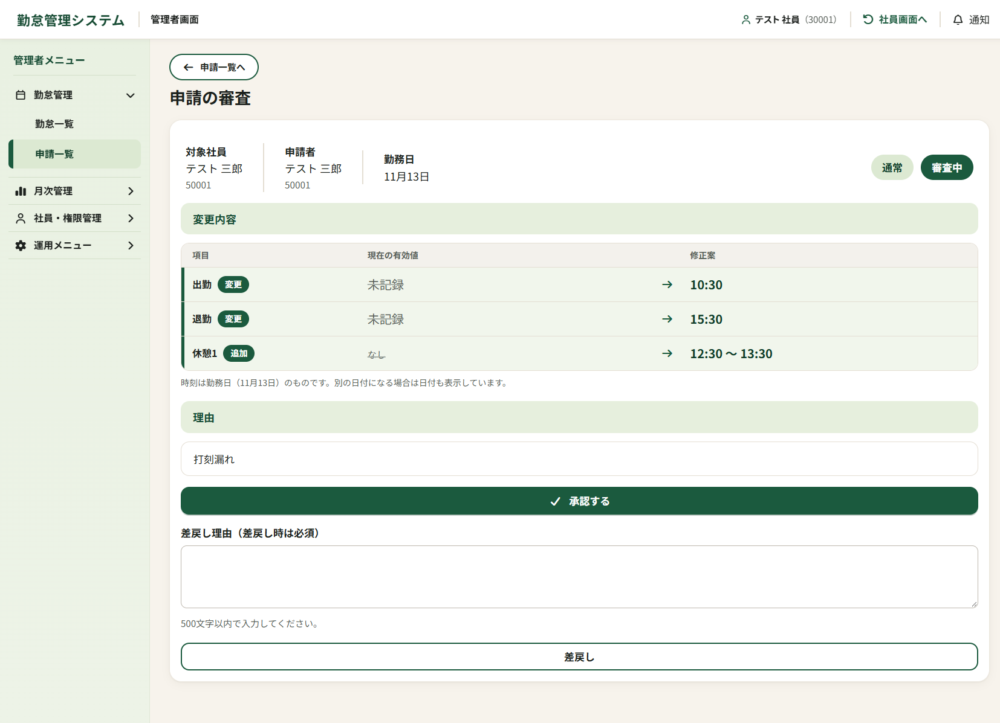

#### 社員管理

社員情報の登録・編集や、所属部署の変更を行う画面です。部署に応じた社員番号の自動採番、アカウントの利用停止・再有効化、初期パスワードの再発行などを管理できます。

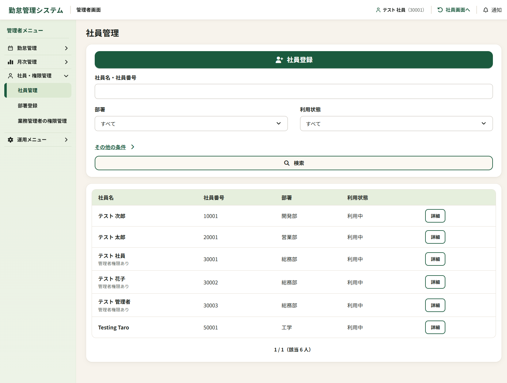

#### 月次詳細と出力

社員ごとの月次勤怠情報を確認・管理する画面です。勤務実績の照合、月次確定・解除、日次明細と月次集計のCSV出力を行えます。

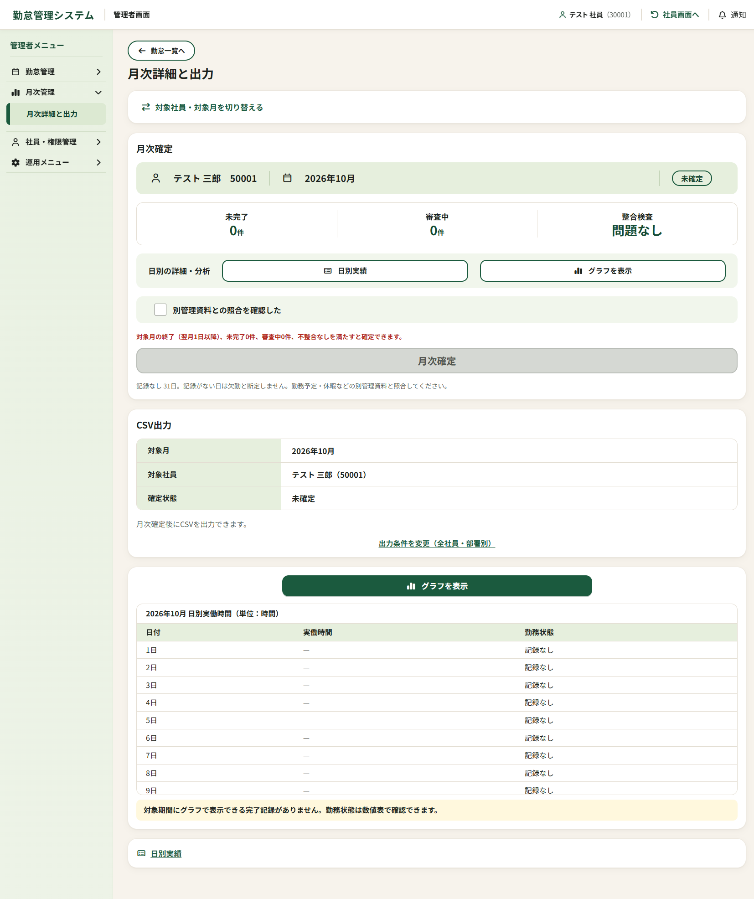

#### 操作履歴

システム内で行われた管理操作や勤怠情報の変更履歴を確認する画面です。操作日時、実行者、変更前後の内容、変更理由などを確認できます。

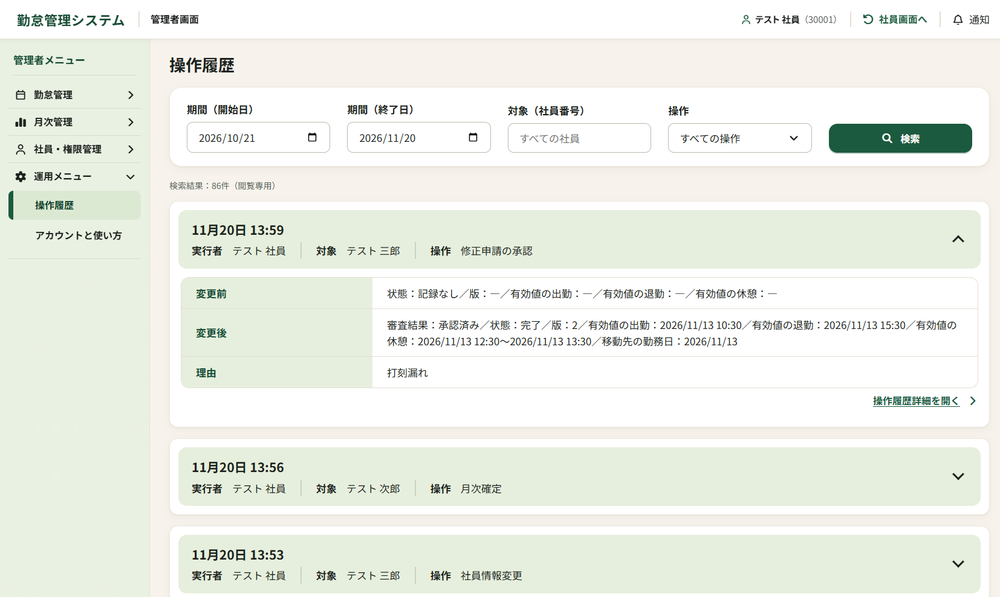

#### 業務管理者の権限管理

社員に対する業務管理者権限の付与・取消を行う画面です。対象社員の利用状態や権限を確認し、変更理由を記録しながら権限を管理できます。

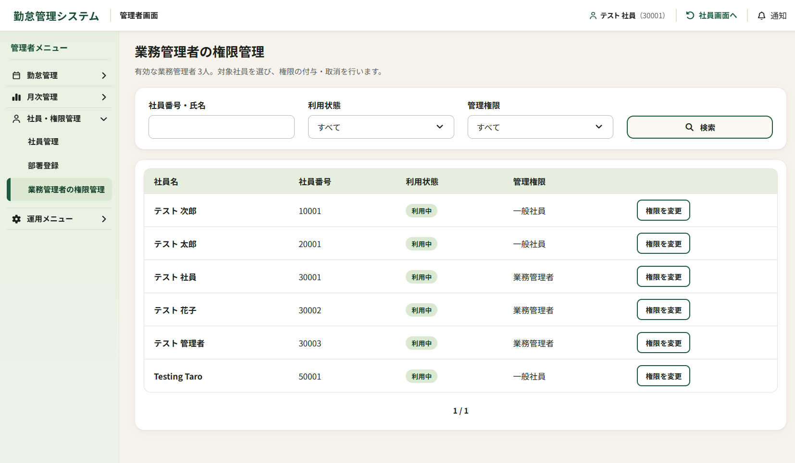

#### 部署登録

新しい部署を登録する画面です。部署名と社員番号の採番に使用するコードを設定し、登録した部署を社員登録時の所属部署として選択できるようにします。

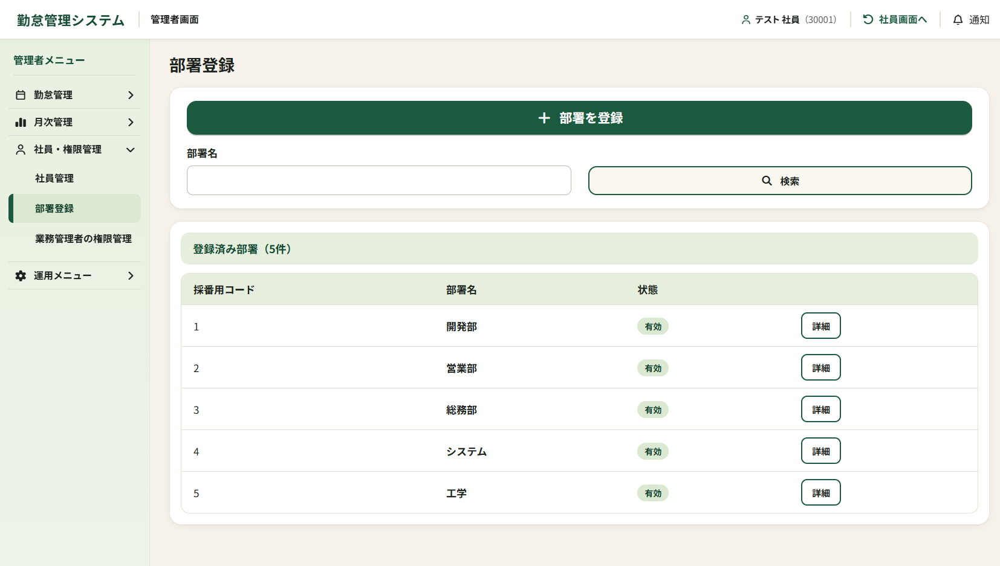

---

## 3. 制作背景・開発目的

### 3.1 制作背景

前職のIT×福祉の職場で、C#を使用した勤怠管理のデスクトップアプリケーションを保守などをした経験があります。

以前制作したアプリケーションでは、打刻画面で社員IDを入力し、出勤・退勤を記録する仕組みを採用していました。

また、打刻画面の下部には勤怠情報の一覧を表示するボタンを設け、登録済み社員の勤怠状況を確認できる構成としていました。

この経験をもとに、ブラウザーから利用できるWebアプリケーションを新たに開発したいと考え、Djangoを使用した勤怠管理システムの制作に取り組みました。

今回のシステムでは、一般社員と業務管理者で必要な機能が異なることを考慮し、それぞれの画面を分離しています。

さらに、勤怠修正申請、承認、月次確定、部署管理、権限制御、操作履歴など、実際の勤怠管理業務で必要となる処理を設計対象に加えました。

### 3.2 開発目的

本システムの開発目的は、勤怠管理業務の効率化と、利用者にとって分かりやすい操作環境の提供です。

具体的には、以下を目指しています。

- 出退勤・休憩の記録を効率化する
- 勤怠情報を一元管理する
- 打刻修正申請と承認業務を効率化する
- 社員情報・部署情報を適切に管理する
- 月次勤怠の確認とCSV出力を効率化する
- 利用者の権限に応じた操作範囲を設定する
- 勤怠データの変更履歴を追跡できるようにする
- 幅広い利用者が操作しやすい画面を目指す

### 3.3 市場調査と機能選定

開発にあたり、国内の勤怠管理サービスであるKING OF TIME、ジョブカン勤怠管理、freee人事労務の公式情報を参考に、勤怠記録から管理者による確認・承認・出力までの業務の流れを調査しました。

その結果、初期版では勤怠記録、修正申請、承認、月次確認、CSV出力を中心とした機能構成を採用しています。

一方、給与計算やシフト作成などは対象外とし、勤怠実績の記録と管理に開発範囲を絞っています。

---

## 4. 主な機能

### 4.1 一般社員向け機能

| 機能                 | 概要                           |
| -------------------- | ------------------------------ |
| ログイン・ログアウト | 社員番号とパスワードによる認証 |
| 出勤・退勤打刻       | 勤務開始・終了時刻の記録       |
| 休憩打刻             | 休憩開始・終了時刻の記録       |
| 勤怠履歴             | 過去の勤怠記録の確認           |
| 日別・月別勤怠       | 勤務時間や勤務状態の確認       |
| 修正申請             | 打刻の追加・変更・取消の申請   |
| 申請状況確認         | 審査中・承認・差戻しなどの確認 |
| アプリ内通知         | 自分宛の通知の確認・既読管理   |
| 勤怠グラフ           | 日別実働時間の可視化           |
| パスワード変更       | 初回変更・通常変更             |
| 操作ガイド           | 各機能の利用方法の確認         |

### 4.2 業務管理者向け機能

| 機能               | 概要                                 |
| ------------------ | ------------------------------------ |
| 勤怠一覧           | 全社員の勤怠情報の確認               |
| 修正申請管理       | 申請の承認・差戻し                   |
| 代理修正申請       | 利用停止中社員の勤怠訂正             |
| 社員管理           | 社員の登録・編集・利用停止・再有効化 |
| 部署管理           | 部署登録と部署情報の管理             |
| 社員番号自動採番   | 部署別の社員番号発行                 |
| 初期パスワード発行 | 新規社員登録時の初期認証情報生成     |
| 月次確定           | 社員別の月次勤怠の確定・解除         |
| CSV出力            | 日次明細・月次集計の出力             |
| 権限管理           | 業務管理者権限の付与・取消           |
| 操作履歴           | 管理操作・変更履歴の確認             |
| 通知               | 管理業務に関する通知の確認           |
| 勤怠グラフ         | 日別実働時間・未完了件数の可視化     |

---

## 5. 使用技術・システム構成

### 5.1 技術スタック

| 分類                 | 使用技術                     |
| -------------------- | ---------------------------- |
| プログラミング言語   | Python / JavaScript          |
| バックエンド         | Django 5.2系                 |
| フロントエンド       | HTML5 / CSS3 / JavaScript    |
| テンプレートエンジン | Django Templates             |
| データベース         | SQLite                       |
| ORM                  | Django ORM                   |
| グラフ               | Chart.js                     |
| アイコン             | Font Awesome Free            |
| フォント             | Google Fonts（Noto Sans JP） |
| 開発エディター       | Visual Studio Code           |
| 開発OS               | Windows 11                   |
| バージョン管理       | Git / GitHub                 |

### 5.2 Djangoを採用した理由

Djangoは、ユーザー認証、フォーム処理、テンプレートなど、Webアプリケーション開発に必要な機能を備えています。

本システムでは、これらの機能を活用しながら、勤怠管理に固有の業務処理や画面を開発する構成としています。

### 5.3 データベースの採用

データベースには、デモ環境と本番環境で異なるデータベースを採用する方針です。

デモ環境では、環境構築や管理が比較的容易な**SQLite**を使用しています。

本番運用時には、複数ユーザーによる同時アクセスやデータの整合性、拡張性を考慮し、**PostgreSQL**を採用する予定です。

### 5.4 アプリケーションの分割

Djangoのアプリケーションを機能ごとに分割しています。

- `accounts`：アカウント管理
- `attendance`：打刻・勤怠記録
- `corrections`：勤怠修正申請
- `management`：社員・部署・権限管理
- `auditlog`：監査ログ
- `notifications`：通知機能

機能ごとに責務を分離することで、コードの管理・保守・機能追加を行いやすい構成を目指しています。

---

## 6. 技術的な工夫・業務ルール

### 6.1 利用者ごとの権限制御

本システムでは、一般社員と業務管理者の2種類の業務上の役割を設定しています。

一般社員は自分自身の勤怠情報を扱い、業務管理者は権限に応じて全社員の勤怠管理業務を行います。

管理権限は所属部署の名称だけでは付与せず、アカウントの利用状態と業務管理者権限によって判定する設計です。

また、以下のルールを設けています。

- 一般社員による他社員の勤怠情報へのアクセスを禁止
- 修正申請の対象社員本人による自己承認・自己差戻しを禁止
- 申請作成者による自己承認・自己差戻しを禁止
- 管理者自身の月次確定・解除は別の管理者が実施
- 有効な業務管理者を2人以上維持する運用
- 管理者数が2人未満になる権限取消・利用停止を拒否
- 権限変更の理由と変更履歴を記録

画面の表示制御だけでなく、サーバー側でも操作権限と対象範囲を確認することを要件としています。

### 6.2 部署別の社員番号自動採番

社員登録時に所属部署を選択すると、その部署に対応した社員番号を自動採番する仕組みです。

社員番号は、部署コード1桁と連番4桁で構成します。

| 部署               | 部署コード | 社員番号の例        |
| ------------------ | ---------- | ------------------- |
| システム部         | 1          | 10001、10002、10003 |
| 営業部             | 2          | 20001、20002、20003 |
| ITソリューション部 | 3          | 30001、30002、30003 |

主なルールは以下のとおりです。

- 社員番号は手入力できない
- 部署ごとに連番を管理する
- 使用済みの社員番号は再利用しない
- 退職などによる欠番は埋めない
- 同じ部署のまま編集する場合は番号を維持する
- 部署異動時は異動先部署の新しい番号を割り当てる
- 異動前の社員番号は履歴として保持する
- 同時登録による重複採番を防止する
- 連番が9999に達した部署では新規採番を停止する

例えば、システム部の社員番号10001の社員が営業部へ異動し、営業部で20001まで発行済みの場合、新しい社員番号は20002となります。

次回ログインでは新しい社員番号と既存のパスワードを使用します。

### 6.3 打刻状態と勤務時間の管理

打刻操作は、現在の勤務状態に応じて制御する設計です。

| 現在の状態 | 実行可能な操作             |
| ---------- | -------------------------- |
| 未出勤     | 出勤                       |
| 勤務中     | 休憩開始・退勤             |
| 休憩中     | 休憩終了                   |
| 退勤済み   | 同一勤務日の訂正は修正申請 |

記録時刻にはサーバーの受信日時を使用し、端末時計を記録の根拠にはしません。

日時はUTCで保存し、画面とCSVでは日本時間に変換します。

実働時間は以下の式で計算します。

**実働時間 ＝ 退勤日時 − 出勤日時 − 休憩時間の合計**

秒単位の記録を保持し、画面では時間と分で表示します。

複数回の休憩、日付をまたぐ勤務、勤務時間の重複、未完了勤務なども考慮した設計です。

### 6.4 打刻の重複・同時更新対策

通信の再送や複数操作によって、勤怠データが重複登録されないようにする設計です。

- 操作IDによる再送判定
- 同一操作ID・同一内容の再送では元の結果を返す
- 同一操作IDで内容が異なる場合は拒否
- 勤務IDとデータ版による更新対象の確認
- 更新直前の権限と勤務状態の再検証
- 不整合がある場合は保存せず、最新状態の確認を案内

SQLiteのトランザクションと一意制約を活用し、データの整合性を保つことを目指しています。

### 6.5 勤怠修正申請と承認

打刻に誤りがあった場合は、修正申請を通じて訂正します。

修正申請では以下を対象とします。

- 打刻の追加
- 打刻日時の変更
- 打刻の取消
- 休憩時間の追加・変更・取消
- 勤務日の変更

申請理由を記録し、修正前後の値を比較できる構成としています。

承認時には、対象社員、申請者、元の勤務データ、月次確定状態などを再確認する設計です。

### 6.6 利用停止中社員の代理申請

利用停止中の社員は、自分で勤怠修正申請を行えません。

そのため、有効な業務管理者が証跡を残して代理申請できる仕組みを要件としています。

代理申請では、修正理由に加えて、本人が申請できない理由や確認した資料の情報を記録します。

代理申請の作成者は自分の申請を承認できず、別の有効な業務管理者が審査します。

### 6.7 月次確定とデータの整合性

月次勤怠は、対象月の翌月1日00:00（日本時間）以降に確定できる設計です。

確定前には、未完了勤務、審査中の修正申請、勤務時間の重複、在籍期間との整合性などを確認します。

また、管理者が別管理資料と照合したことを確認してから確定します。

確定後はデータの版を保持し、訂正が必要な場合は理由付きで解除した後、申請・承認・再照合・再確定を行います。

### 6.8 CSV出力と出力ID管理

月次確定済みの勤怠情報を、以下の2種類のCSVとして出力する設計です。

- 日次明細CSV
- 月次集計CSV

両方のCSVは同じ出力IDに関連付けられます。

出力後に対象データが解除・再確定された場合は、旧出力IDを失効させ、新しい確定版から再発行します。

CSVの形式は以下を要件としています。

| 項目       | 仕様                |
| ---------- | ------------------- |
| 文字コード | UTF-8 BOM付き       |
| 区切り文字 | カンマ              |
| 改行コード | CRLF                |
| ヘッダー   | あり                |
| 日付       | YYYY-MM-DD          |
| 日時       | YYYY-MM-DD HH:mm:ss |
| 時間データ | 秒単位の整数        |

また、CSVを表計算ソフトで開いた際の数式解釈リスクにも配慮し、特定の文字で始まる文字列には接頭辞を付与する仕様です。

### 6.9 操作履歴・監査ログ

勤怠情報の修正や管理操作について、変更内容を確認できるようにしています。

主な記録対象は以下のとおりです。

- 操作した利用者
- 操作対象
- 操作内容
- 変更前後の値
- 変更理由
- 操作日時
- 権限の付与・取消
- 部署登録
- 月次確定・解除
- CSV出力

操作履歴は、業務上の変更を追跡するための重要な情報として扱います。

---

## 7. UI・UX・ユニバーサルデザイン

本システムでは、利用者が迷わず操作できる画面を目指しています。

### 7.1 UI・UXの設計方針

- シンプルで分かりやすい画面構成
- 主要操作へのアクセスのしやすさ
- 利用者の役割に応じた画面の分離
- 操作結果を明確に伝えるメッセージ
- エラー発生時の原因と対処方法の案内
- 入力ミスを防ぐための確認表示
- 画面間で統一したボタン・入力欄・表示形式

### 7.2 階層メニュー

社員画面と管理者画面では、それぞれの役割に応じた階層メニューを使用します。

**社員メニュー**

- 打刻メニュー
  - 打刻ホーム
- 勤怠メニュー
  - 自分の勤怠
- アカウントメニュー
  - アカウントと使い方

**管理者メニュー**

- 勤怠管理
  - 勤怠一覧
  - 申請一覧
- 月次管理
  - 月次詳細と出力
- 社員・権限管理
  - 社員管理
  - 部署登録
  - 業務管理者の権限管理
- 運用メニュー
  - 操作履歴
  - アカウントと使い方

### 7.3 ユニバーサルデザイン

- 読みやすい文字サイズと配色
- 分かりやすいボタンと文字ラベル
- アイコンだけに依存しない情報伝達
- 操作結果とエラーを文字でも表示
- 利用者が現在の画面や状態を把握しやすい構成

---

## 8. アクセシビリティ・レスポンシブデザイン

### 8.1 アクセシビリティ

WCAG 2.2 レベルAAを適合目標としています。

主な設計・検証項目は以下のとおりです。

| 項目               | 設計目標                               |
| ------------------ | -------------------------------------- |
| 文字のコントラスト | 通常文字4.5:1以上                      |
| 大きな文字         | 3:1以上                                |
| キーボード操作     | Tab・Enterなどで操作可能               |
| フォーカス         | 現在位置を視覚的に確認可能             |
| フォーム           | ラベル・必須項目・エラーの明示         |
| 読み上げ           | 適切な見出し・ランドマーク・状態通知   |
| ボタンサイズ       | 主なボタンは44×44 CSS px以上を設計目標 |
| 文字拡大           | 200％拡大への対応                      |
| 狭い画面           | 320 CSS px幅への対応                   |

WCAG 2.2 レベルAAは適合目標であり、適合認証を取得したものではありません。

### 8.2 レスポンシブデザイン

以下のデバイスでの利用を想定しています。

- デスクトップPC
- ノートPC
- タブレット
- スマートフォン

スマートフォンでは、主要操作を優先した1列レイアウトを基本とします。

管理一覧は、画面幅に応じてカード表示や詳細リンクを活用し、必要な情報へアクセスできる設計としています。

### 8.3 フォント・アイコン

標準フォントにはGoogle Fontsの**Noto Sans JP**を使用します。<br>
※リンク：https://fonts.google.com/

アイコンにはFont Awesome Free（を使用し、文字ラベルと組み合わせることで、アイコンだけに依存しない操作画面を目指しています。<br>
※リンク：https://fontawesome.com/

グラフにはChart.jsを使用し、数値表との切り替えを可能にする設計です。

---

## 9. アプリ内通知

勤怠に関する重要な情報を利用者に伝えるため、アプリ内通知を設けています。

### 9.1 通知の種類

| 通知ID | 通知内容                   |
| ------ | -------------------------- |
| N01    | 修正申請の到着             |
| N02    | 修正申請の承認・差戻し結果 |
| N03    | 未完了記録の確認           |
| N04    | 月次確定・解除・再確定     |

### 9.2 通知の設計

- 通知アイコンと未読件数の表示
- 通知パネルと一覧画面
- 未読通知の絞り込み
- 個別既読・すべて既読
- 関連画面へのリンク
- 権限に応じた通知の表示制御
- 同一業務イベントによる重複通知の防止

未完了記録の検出は、毎日09:00（日本時間）に実行する定期処理を要件としています。

メール通知やOSプッシュ通知は初期版の対象外です。

---

## 10. セキュリティ

本システムでは、ユーザー認証・アクセス制御・個人情報保護を重視しています。

### 10.1 セキュリティ設計

- Djangoによるユーザー認証
- パスワードのハッシュ化
- 権限に応じたアクセス制御
- CSRF対策
- テンプレートの自動エスケープ
- 環境変数による秘密情報の管理
- 管理操作の監査履歴
- ログイン失敗回数の制限
- 初回ログイン時のパスワード変更
- 利用停止時のセッション無効化

本番環境ではHTTPSの使用、DEBUGの無効化、Cookieのセキュリティ設定などを必須とする設計です。

### 10.2 初期パスワード

社員登録時には、初期パスワードを自動生成する仕様です。

- Pythonの`secrets`を使用
- 20文字の英数字
- 見分けにくい文字を除外
- 発行時から72時間の有効期限
- 初回ログイン時にパスワード変更を要求
- 初期パスワードの平文は発行直後の完了画面のみで表示

初期パスワードの平文をデータベースやログに保存しない設計としています。

### 10.3 公開リポジトリの情報保護

`.env`、秘密鍵、実データを含むSQLiteデータベース、バックアップ、個人情報を含むログは公開対象から除外します。

---

## 11. テスト・品質管理

### 11.1 自動テスト

Djangoのテスト機能を使用して、システムの動作確認を行います。

```powershell
python manage.py test
```

主なテスト対象は以下のとおりです。

- ログイン・ユーザー認証
- 出勤・退勤・休憩の打刻
- 勤務時間の計算
- 勤怠修正申請と承認処理
- 社員登録・部署管理
- 社員番号の自動採番
- 権限制御
- 月次確定・解除
- CSV出力
- アプリ内通知
- 操作履歴

### 11.2 受入試験

要件定義書v1.5.7では、T01〜T19の受入試験を定義しています。

主な確認対象は、権限制御、打刻、時間計算、修正申請、月次確定、CSV出力、アクセシビリティ、SQLiteの同時更新、バックアップ・復元、部署登録、階層メニューなどです。

本番リリースの判定には、受入試験の合格、重大な未解決不具合がないこと、導入前の運用条件を満たすことが必要です。

---

## 12. ディレクトリ構成

主要なディレクトリとファイルを以下に示します。

```text
attendance_system_v1.5.7/
├── accounts/              # アカウント管理
├── attendance/            # 打刻・勤怠記録
├── auditlog/              # 操作の監査ログ
├── config/                # Djangoのプロジェクト設定
├── corrections/           # 勤怠修正申請
├── management/            # 社員・部署・権限管理
├── notifications/         # 通知機能
├── templates/             # DjangoのHTMLテンプレート
│   ├── accounts/
│   ├── components/
│   ├── corrections/
│   ├── employee/
│   ├── management/
│   └── notifications/
├── static/                # 静的ファイル
│   ├── css/
│   ├── img/
│   ├── js/
│   └── vendor/
│       └── chartjs/
├── docs/                  # ドキュメント・画面画像
│   └── screenshot/
├── scripts/               # 運用・保守用スクリプト
├── manage.py              # Django管理コマンド
└── requirements.txt       # Pythonの依存パッケージ
```

---

## 13. インストール・起動方法

Windows環境でのローカル起動手順です。

### 13.1 動作環境

| 項目          | 内容       |
| ------------- | ---------- |
| OS            | Windows 11 |
| Python        | 3.12.10    |
| Django        | 5.2.19     |
| データベース  | SQLite     |
| macOS / Linux | 未検証     |

### 13.2 プロジェクトの取得

GitHubからリポジトリをダウンロードし、任意のフォルダーに展開してください。

### 13.3 仮想環境の作成

PowerShellでプロジェクトのルートディレクトリを開きます。

```powershell
py -m venv .venv
```

### 13.4 仮想環境の有効化

```powershell
.\.venv\Scripts\Activate.ps1
```

### 13.5 パッケージのインストール

```powershell
python -m pip install -r requirements.txt
```

### 13.6 環境設定

本システムでは、Djangoの秘密鍵やデバッグモードを環境変数で管理しています。

ローカル開発用の設定例は以下のとおりです。

```dotenv
DJANGO_SECRET_KEY=ローカル開発用の秘密鍵
DJANGO_DEBUG=True
```

環境変数の読み込み方法はプロジェクトの設定に従ってください。

`.env`を使用する場合はGitの管理対象から除外し、実際の秘密鍵をGitHubに公開しないでください。

### 13.7 データベースのマイグレーション

```powershell
python manage.py migrate
```

### 13.8 初期管理者の設定

本システムでは、Djangoの技術管理用アカウントと、勤怠管理業務を行う業務管理者権限を区別しています。

初期アカウントの作成と業務管理者権限の付与は、プロジェクトの初期設定手順に従って行います。

業務管理者は2人以上を配置する運用を前提としています。

### 13.9 開発サーバーの起動

```powershell
python manage.py runserver
```

### 13.10 ブラウザーでアクセス

以下のURLにアクセスしてください。

http://127.0.0.1:8000/

この手順はローカル開発用です。

---

## 14. 対応範囲・制約事項

### 14.1 対応対象

- 固定時間制の勤怠記録
- 1日1勤務を基本とする打刻
- 複数回の休憩
- 日付をまたぐ勤務
- 勤怠修正申請
- 月次勤怠の確定
- 日次・月次CSV出力

### 14.2 初期版の対象外

- 給与計算
- 有給休暇の付与・残数管理
- 休暇申請
- シフト作成
- フレックスタイム制などの勤務制度別計算
- 法定時間外・休日・深夜割増の自動判定
- GPS打刻
- 生体認証
- ICカード打刻
- 外部サービス連携
- 複数段階の承認
- メール・OSプッシュ通知

本システムは勤怠実績の記録と確認を支援するものであり、給与計算や法令に基づく労務管理業務のすべてを代替するものではありません。

正式導入時には、利用企業の就業規則や運用方法、法令への対応を別途確認する必要があります。

---

## 15. 今後の改善・検討事項

- UI・UXとアクセシビリティの継続的な改善
- 利用ユーザーの要望への対応改善

---

## 16. ライセンス・お問い合わせ

### 16.1 ライセンス

現在、本リポジトリにはオープンソースライセンスを設定していません。

公開は閲覧を目的としており、利用・改変・再配布の許諾を意味しません。

### 16.2 お問い合わせ

不具合報告や改善要望については、以下のフォームからお問い合わせください。

https://forms.gle/iWeCt6rDpUH4fN7s9

---

## 17. 開発者情報

### Rion Tanaka

Webサイト・Webアプリケーションの開発に取り組んでいます。

利用者にとって分かりやすく、使いやすいシステムの制作を目指しています。

UI・UX・アクセシビリティ・セキュリティ・保守性を意識して開発しています。

---

Copyright © 2003-2026 Rion Tanaka
